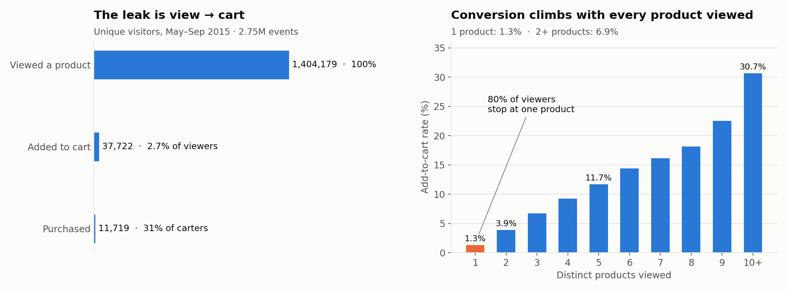
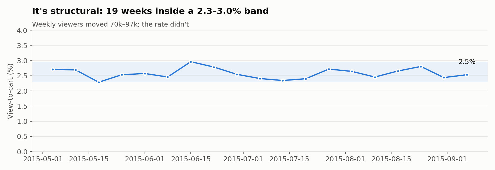
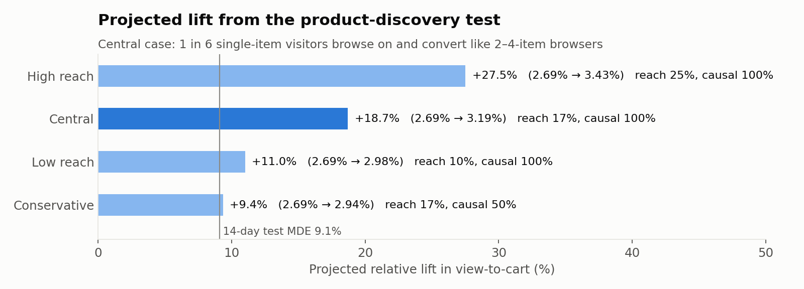
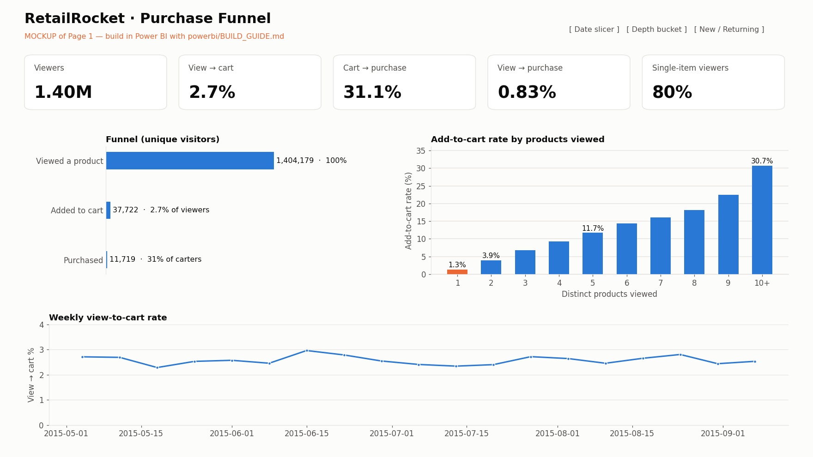

# RetailRocket 用户行为漏斗分析：复现与指标口径改进

基于 gurmeshsingh/RetailRocket-Funnel-Analysis，
完成原项目复现，并围绕时间顺序、商品一致性和转化窗口
开展三项改进。

技术栈：MySQL 8、Python、PowerShell、Power BI、Git。

## 完成的工作

- 复现2,756,101条事件数据的处理、SQL分析与图表生成。
- 保存原版结果、运行日志、依赖版本和输入文件哈希。
- 构建用户级24小时有序漏斗，并分解统计口径变化的影响。
- 增加同商品链路要求，按用户去重比较转化人数与比例。
- 固定7天完整观察期人群，比较1小时、24小时和7天窗口。
- 建立CSV导出脚本，并制作6页Power BI报表。

## 主要发现

### 1. 时间顺序与统计口径

原版全期独立阶段人数比值为2.6864%。

加入浏览与加购交集、完整观察期、时间顺序和24小时限制后，
用户级有序漏斗为：

1,399,102名浏览用户 → 28,195名加购用户 → 7,915名购买用户。

浏览到加购比例为2.0152%。
各项口径变化的影响已分别拆解，详见分析文档。

### 2. 同商品要求

在相同用户人群和24小时窗口下，增加同商品要求后，
合格加购用户从28,195人变为26,125人，
合格购买用户从7,915人变为7,693人。

### 3. 转化窗口

固定同一批1,345,063名具备7天完整观察期的用户，
并要求同商品、按时间顺序转化：

- 1小时内购买5,882人，占7天合格购买用户的70.97%。
- 24小时内购买7,445人，覆盖89.83%。
- 7天内购买8,288人，比24小时额外纳入843人。

原项目约18.7%的相对提升属于假设驱动的情景预估。

## 结果入口

- [改进说明与运行顺序](reports/improved/README.md)
- [同商品链路分析](reports/improved/same_item_analysis.md)
- [转化窗口分析](reports/improved/window_sensitivity.md)
- [Power BI主报表](powerbi/RetailRocket_Improved.pbix)

## 版本记录

| 标签 | 内容 |
|---|---|
| baseline-v1 | 原版复现与结果归档 |
| ordered-funnel-v1 | 用户级24小时有序漏斗 |
| same-item-funnel-v1.1 | 同商品链路分析与归档修正 |
| window-sensitivity-v1 | 固定人群的转化窗口分析 |

---


# RetailRocket E-Commerce Funnel Analysis (SQL · Power BI)

**Why do 97% of shoppers on this store never add anything to their cart, and what test would fix it?**

I analyzed **2.75M real e-commerce events from 1.4M visitors** in SQL to map the purchase funnel. I found a **structural 2.7% view-to-cart conversion** driven by the **80% of visitors who bounce after viewing a single item**. From that I designed a product-discovery A/B test **projected to lift conversion by 19% relative**, with a formal hypothesis, primary and guardrail metrics, sample size and success criteria.



---

## Key results

| | |
|---|---|
| Events analyzed | **2,756,101** (views, add-to-carts, purchases) |
| Unique visitors | **1,407,580** (1,404,179 viewed a product) |
| View → cart | **2.7%** (37,722 of 1,404,179 viewers) |
| Cart → purchase | **31.1%** (checkout is not the problem) |
| Viewers who see only 1 item | **79.6%** (and they add to cart at just **1.3%**) |
| Viewers who see 2+ items | add to cart at **6.9%**, about 5x higher |
| Recommended test | "You may also like" strip on the product page |
| Projected lift | **+19% relative** (2.69% → 3.19%), 14-day test, MDE 9.1% |

---

## Project structure

```
├── sql/
│   ├── 00_setup.sql                          load events.csv and build visitor_summary
│   ├── 01_data_profile_and_funnel.sql        scale, event mix, unique-visitor funnel
│   ├── 02_trend_is_it_structural.sql         weekly view-to-cart stability
│   ├── 03_driver_single_item_bounce.sql      browse depth, the root cause
│   ├── 04_retention.sql                      returning visitors and repeat buyers
│   ├── 05_experiment_baseline_and_projection.sql   A/B baseline, traffic, lift model
│   └── 06_powerbi_exports.sql                extracts for the dashboard
├── experiment/
│   ├── ab_test_plan.md                       full test design
│   ├── power_and_projection.py               sample size, duration and MDE
│   └── key_numbers.json                      every headline number, machine-generated
├── powerbi/
│   ├── data/*.csv                            dashboard-ready extracts
│   ├── measures.dax                          all DAX measures
│   ├── BUILD_GUIDE.md                        page-by-page build instructions
│   └── dashboard_mockup.png
├── scripts/
│   ├── build_outputs.py                      rebuilds every number from events.csv (no MySQL needed)
│   └── make_charts.py
└── images/
```

**Tools:** MySQL 8 (analysis), Power BI (dashboard and A/B planner), Python (reproducibility checks and power analysis).

---

## The data

Real, anonymized behavior from an online retailer, published by [RetailRocket on Kaggle](https://www.kaggle.com/datasets/retailrocket/ecommerce-dataset). The period is 3 May to 18 Sep 2015 (about 4.5 months, all dates UTC). Each row is one `view`, `addtocart` or `transaction`, with a timestamp, visitor ID and item ID. The data has no prices, so impact is measured in conversion rather than revenue.

---

## 1. The funnel: where it leaks

([`sql/01`](sql/01_data_profile_and_funnel.sql)) Measured at the **unique-visitor** level, because raw event counts inflate every stage.

| Stage | Visitors | Step conversion |
|---|---|---|
| Viewed a product | 1,404,179 | |
| Added to cart | 37,722 | **2.7%** of viewers |
| Purchased | 11,719 | 31.1% of carters |

The leak is at the first step: **97.3% of viewers never add anything to their cart**. Once something is in the cart, nearly a third of carters buy, so checkout is doing its job. End to end, only 0.83% of visitors purchase.

*Data-quality note:* 3,321 carters have no logged view (tracking gaps). Counting only carters with a logged view gives a strict rate of 2.45%. The conclusion doesn't change.

## 2. It's structural, not a bad patch

([`sql/02`](sql/02_trend_is_it_structural.sql))



Across all 19 full weeks, view-to-cart stayed between **2.29% and 2.96%** (mean 2.58%, SD 0.18pp), while weekly viewers swung from 70k to 97k. Traffic changes, but the rate doesn't. The same experience loses about 97% of viewers every week, so the fix has to be a product change, not a campaign.

## 3. The driver: single-item bounce

([`sql/03`](sql/03_driver_single_item_bounce.sql))

| Items viewed | Viewers | Share | View → cart |
|---|---|---|---|
| 1 item | 1,118,109 | **79.6%** | **1.32%** |
| 2 to 4 | 247,092 | 17.6% | 5.04% |
| 5 to 9 | 29,769 | 2.1% | 14.55% |
| 10+ | 9,209 | 0.7% | 30.69% |

- **Conversion climbs with every product viewed:** 1.3% → 3.9% → 6.8% → 9.2% for 1, 2, 3 and 4 items.
- **Single-item visitors really are bouncing.** 90% had exactly one page view, and 97% were seen on only one day.
- **It's a mix problem.** Visitors who view 2+ items add to cart at **6.85%**. Because 4 in 5 viewers stop at one item (1.32%), the blend collapses to about 2.5%.
- **80.5% of all viewers who never add to cart saw exactly one product.**
- Buyers view **9.6** products on average, against **1.5** for non-buyers.

## 4. Retention context

([`sql/04`](sql/04_retention.sql)) **90%** of visitors are seen on a single day, and **91%** of buyers never order again. For most visitors the first session is the only chance to get them browsing.

---

## 5. Recommendation: a product-discovery A/B test

Full plan: [`experiment/ab_test_plan.md`](experiment/ab_test_plan.md)

**Hypothesis.** Adding a "You may also like" strip to the product page will get more single-item visitors to view a second product. That should lift visitor-level view-to-cart from **2.69% to about 3.19% (+19% relative)**, because browsing depth is the strongest predictor of adding to cart in this store.

| | |
|---|---|
| Unit / split | Visitor, 50/50, sticky assignment |
| **Primary metric** | View-to-cart conversion (baseline 2.69%) |
| Secondary | Avg items viewed (1.52), single-item share (79.6%), view-to-purchase (0.83%), strip CTR |
| **Guardrails** | Cart-to-purchase must not drop >5% relative (baseline 31.1%) · page load p75 +200 ms max · no bounce increase · SRM check |
| Duration | 14 days, about 71.8k visitors per arm, **MDE 9.1% relative** at α = 0.05 and 80% power |
| **Ship if** | Primary lift significant (p < 0.05), CI lower bound > 0, and no guardrail breached |

### Where the 19% comes from

([`sql/05`](sql/05_experiment_baseline_and_projection.sql), [`power_and_projection.py`](experiment/power_and_projection.py))



```
extra carters = 1,118,109 single-item viewers × reach × causal share × (5.04% − 1.32%)
```

In the **central case**, the strip gets **1 in 6 (17%) single-item visitors** to browse on, and they convert like today's 2–4-item browsers. That gives **+7,057 carters, +18.7% ≈ 19%**, moving the rate from 2.69% to 3.19%. Some of the observed gap is self-selection, so the **conservative case** credits only half of it (+9.4%). The 14-day test is sized to detect even that case (MDE 9.1%).

---

## 6. Power BI dashboard



The dashboard has three pages:

1. **Funnel overview:** KPI cards, funnel, conversion by depth, weekly trend.
2. **Why it leaks:** the depth table, the 5x multiplier and retention.
3. **A/B test planner:** What-if sliders for reach and causal share that recompute the projected lift live, plus a sample-size calculator.

Data extracts, DAX measures and build steps are in [`powerbi/`](powerbi/BUILD_GUIDE.md).

---

## Reproduce it

**MySQL.** Download `events.csv` from Kaggle. Set its path in `sql/00_setup.sql`, then run the files in order.

**Without MySQL:**

```bash
pip install pandas matplotlib
python scripts/build_outputs.py /path/to/events.csv   # rebuilds and checks every number
python experiment/power_and_projection.py             # sample size and MDE
python scripts/make_charts.py                         # charts and mockup
```

`build_outputs.py` asserts the headline numbers, so if anything in this README drifted from the data, the script fails.

---

## Limitations and next steps

- **Correlation, not causation.** Deeper browsers may simply be more motivated. That is why the projection includes a 50% causal haircut and why the answer is a test rather than a launch.
- **No revenue data.** Impact is in conversion. In production, add average order value and revenue per visitor as guardrails.
- **No session IDs.** "Bounce" is approximated as one distinct product viewed (90% of these visitors had a single page view).
- **Next:** use `item_properties` and `category_tree` to find which categories pull people into deeper browsing, and seed recommendations from them.

---

*Analysis by Gurmesh Singh.*
