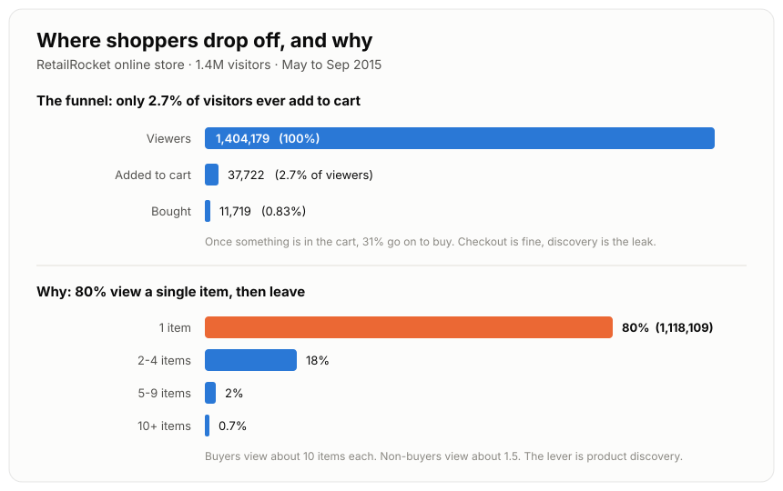

# RetailRocket E-Commerce Funnel Analysis

**Where do online shoppers drop off before buying, and what should the business actually do about it?**

I took 2.75 million real user events from an online store and used SQL to figure out where the funnel breaks, why it breaks there, and what experiment I'd run to fix it.

---

## The short version

Only about 2.7% of visitors ever add something to their cart. That number barely moves week to week, so this isn't a bad month or a seasonal dip. It's baked into the experience.

Dig into behavior and the reason gets clear fast. Eight out of ten visitors look at a single product and leave. The people who actually buy behave completely differently: they browse around ten items each before checking out. On top of that, 90% of visitors never come back, and even among buyers, 9 in 10 never place a second order.

So the store is good at pulling people in and fine at closing the ones who engage. The gap is in the middle. Most visitors never explore enough to find something worth buying. My recommendation is to help those one-item browsers discover more products, and I've laid out an A/B test to prove whether it works.

---

## The data

This is real, anonymized behavior from an online retailer, published by RetailRocket on Kaggle.

| | |
|---|---|
| Events | 2,756,101 |
| Unique visitors | roughly 1.4 million |
| Time span | 3 May 2015 to 18 Sep 2015 (about 4.5 months) |
| Event types | view, addtocart, transaction |

Every row is one thing a visitor did: they viewed an item, added it to cart, or bought it. Each comes with a timestamp, a visitor ID, and an item ID.

**Tools:** MySQL for everything. All the queries live in [`analysis.sql`](analysis.sql).

---

## What I set out to answer

Simple goal. Find the single biggest leak on the path to purchase, explain why it happens, and recommend a fix I could actually test.

---

## What I found

### The funnel, and where it leaks

I measured this at the unique-visitor level rather than raw event counts. Raw counts lie here, because one person views lots of items and that inflates everything.

| Stage | Visitors | Conversion |
|---|---|---|
| Viewed something | 1,404,179 | |
| Added to cart | 37,722 | 2.7% of viewers |
| Bought | 11,719 | 31.1% of carters |

The leak is right at the start, in the jump from viewing to adding to cart. Only 2.7% of browsers ever cart anything. But look at the next step: once something is in the cart, 31% go on to buy. Checkout is doing its job. Discovery is where people fall away. End to end, only 0.83% of visitors buy anything.

### It's structural, not a bad patch

Weekly active users held steady between 70,000 and 95,000, and the view-to-cart rate never left the 2.3% to 3.0% band across every full week in the data. Nothing about it self-corrects. Week after week the same experience stops roughly 97% of visitors from carting.

### Buyers browse. Everyone else bounces.

| Type of visitor | Average items viewed |
|---|---|
| Didn't buy | 1.45 |
| Bought | 9.61 |

Buyers look at about six and a half times more items than non-buyers. When I break every viewer down by how much they browsed, the picture is stark:

| Items viewed | Visitors | Share of viewers |
|---|---|---|
| 1 item | 1,118,109 | 80% |
| 2 to 4 items | 247,092 | 18% |
| 5 to 9 items | 29,769 | 2% |
| 10 or more | 9,209 | 0.7% |

Eighty percent of visitors see one product and are gone. They never get far enough to find something they'd want.

### People don't come back

Ninety percent of visitors show up on a single day and never return. And of the customers who did buy, only about 9% ever bought again. The store leans hard on fresh traffic instead of bringing people back.

---

## The one thing that matters

The store attracts visitors well and converts the engaged ones well enough. Its real problem is the huge middle group it never engages at all. Most people never browse past a single product, and single-product visitors almost never buy. The buyers are exactly the ones who explored a lot of items.

That points at one lever: product discovery. If I can get one-item browsers to view a few more relevant products, I'm nudging them toward the exact behavior that already leads to sales.

---

## What I'd do about it, and how I'd test it

### The idea

Add a "You may also like" recommendation strip to the product page. My bet is that it gets people to view more items, which lifts the view-to-cart rate, especially for the 80% who currently look at just one thing.

### How the test is set up

| | |
|---|---|
| Who gets split | Visitors |
| Group A (control) | The product page as it is today |
| Group B (variant) | The same page plus a related-items strip |
| Main thing I'm measuring | View-to-cart conversion rate |
| Also watching | Average items viewed, and overall view-to-purchase rate |
| Safety checks | Page load time and bounce rate |

### What counts as a win

A clear, statistically significant lift in view-to-cart, with no damage to the safety-check metrics. Starting from a 2.7% baseline, even half a percentage point of absolute lift (getting to around 3.2%) is close to a 19% relative gain, and at 1.4 million visitors that's real money.

### Why this fix and not another

It goes straight at the problem the data actually shows, which is people bouncing after one product. It pushes them toward proven buyer behavior instead of me guessing at price or checkout changes that the numbers say aren't the bottleneck.

---

## Where this could be wrong, and what's next

I want to be honest about the limits.

There's no revenue in this dataset, so I've framed impact in conversion, not money. I didn't use item categories here, and a good follow-up would look at which categories actually pull people deeper into browsing. The A/B test also assumes the recommendations are decent. Bad ones could easily hurt, so I'd pilot the module small before rolling it wide. And a natural next step is proper cohort retention, tracking how fast each week's new visitors drop off over time.

---

*Analysis by Gurmesh Singh. Queries in [`analysis.sql`](analysis.sql).*
